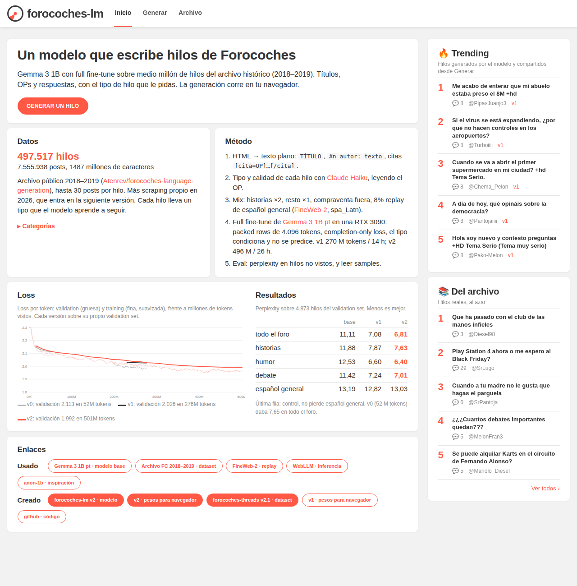

# forocoches-lm

A small language model that writes [ForoCoches](https://forocoches.com) threads: title, opening post and replies, in the forum's Spanish, conditioned on a thread type. Gemma 3 1B fully fine-tuned on half a million archived threads, in the spirit of [anon-1b](https://huggingface.co/scratchyone/anon-1b).

**Live: [forocoches.m19182.dev](https://forocoches.m19182.dev)**. Generation runs in your browser (WebLLM over WebGPU, 575 MB download once); the page is dressed as the forum and also lets you read the real archive.

[](https://forocoches.m19182.dev)

## Releases

| | |
|---|---|
| Model (bf16, Transformers) | [mateo-19182/forocoches-lm-v2](https://huggingface.co/mateo-19182/forocoches-lm-v2) |
| Browser weights (q4f16_1 MLC, for WebLLM) | [forocoches-lm-v2-q4f16_1-MLC](https://huggingface.co/mateo-19182/forocoches-lm-v2-q4f16_1-MLC) · [v1](https://huggingface.co/mateo-19182/forocoches-lm-v1-q4f16_1-MLC) |
| Dataset (171k labelled threads) | [forocoches-threads-v2.1](https://huggingface.co/datasets/mateo-19182/forocoches-threads-v2.1) |

Completion perplexity on 4,873 held-out threads (lower is better):

| | base | v1 | v2 |
|---|---:|---:|---:|
| all forum text | 11.11 | 7.08 | **6.81** |
| historia | 11.88 | 7.87 | **7.63** |
| humor | 12.53 | 6.60 | **6.40** |
| general Spanish (control) | 13.19 | 12.82 | 13.03 |

Version ledger and provenance: [VERSIONS.md](VERSIONS.md). What we learned and the plan for the next run: [docs/NEXT-RUN.md](docs/NEXT-RUN.md).

## How it works

```
tipo: historia

TÍTULO: Lo que me ha pasado hoy en el Mercadona +tocho

#1 OP: Bueno shurs, ayer por la tarde...

#2 forero_a: ...
```

- **Data**: the public 2018–2019 archive ([Atenrev/forocoches-language-generation](https://github.com/Atenrev/forocoches-language-generation)) plus our own crawl. HTML → plain text, authors pseudonymised per thread (`OP`, `forero_a`, …), quotes as `[cita=…]…[/cita]`, exact + MinHash dedup, 1% held out.
- **Labels**: thread type and quality from the opening post with Claude Haiku (`fcdata/label.py`). Only the type is used as a header; it is masked from the loss.
- **Training**: `train.py`, Unsloth + TRL + FlexAttention on one RTX 3090. Packed 4,096-token rows with per-document attention, 65k tokens per step, lr 2e-5 cosine, one epoch, 8% general-Spanish replay (FineWeb-2). v2: 496M tokens in 26 h.
- **Serving**: `scripts/export_webllm.py` quantises a run to MLC q4f16_1 (own torch implementation; `mlc_llm convert_weight` crashed). `web/` is FastAPI + static HTML/JS; the public site is browser-only, the private network also gets the server GPU.

## Layout

| | |
|---|---|
| `collect.py`, `public_crawl.py`, `parallel_fetch.py`, `authenticate.py`, `transport.py` | collectors: resumable, one process per data dir, shared request pacing, stop on login failures / rate limits / challenges, raw HTML kept for audit |
| `fcdata/` | build text from the archive, pseudonyms, labels, dedup, curation, mixes (`mix.py`, `mix_v2.py`) |
| `train.py`, `scripts/gpu_train.sh`, `scripts/watch_run.sh` | trainer, GPU-sharing wrapper, Telegram watcher |
| `scripts/eval_ppl.py`, `scripts/sample.py`, `scripts/check_packing.py` | evaluation |
| `scripts/export_webllm.py`, `web/` | browser weights and the site |
| `scripts/bench/` | attention / LR / slowdown benchmarks from the v1–v2 investigation |
| `systemd/` | example user units (crawler, monitors, web); edit paths before use |
| `tests/` | 98 unit tests on synthetic fixtures |
| `docs/` | [NEXT-RUN.md](docs/NEXT-RUN.md), [DATA-WISHLIST.md](docs/DATA-WISHLIST.md), [RELEASING.md](docs/RELEASING.md) |

## Setup

Python 3.12 on Linux. Three environments, because the training stack is heavy:

```sh
python3 -m venv .venv && .venv/bin/pip install -r requirements.txt          # collectors
.venv/bin/pip install -r requirements-data.txt                               # cleaning, labels, dedup, tests
python3 -m venv .venv-train && .venv-train/bin/pip install -r requirements-train.txt   # CUDA training + web
```

`.env.example` lists the optional settings (`ANTHROPIC_API_KEY` for labelling, `HF_TOKEN` for releases). Public collection needs no credentials.

### Collect

```sh
python public_crawl.py --data data/public-example --stories-only --workers 2 --delay 2 --hours 2
python monitor_crawl.py --data data/public-example --no-desktop
```

Resumes from SQLite; limits persist across restarts. Restricted pages are recorded, access blocks pause collection and need a human look before resuming. `authenticate.py` makes one login attempt from a local account file (never rotates accounts). Keep account files and cookie jars under the ignored `secrets/`.

### Prepare and train

```sh
.venv/bin/python -m fcdata.build --db data/archive-working-copy.sqlite --out data/processed/threads.jsonl
.venv/bin/python -m fcdata.dedup --threads data/processed/threads.jsonl --out data/processed/dedup_drop.json
.venv/bin/python -m fcdata.mix --chunk --fields tipo --out data/mix/<name> ...      # see VERSIONS.md for recipes
scripts/gpu_train.sh .venv-train/bin/python train.py --data data/mix/<name> --out runs/<v>
.venv-train/bin/python scripts/eval_ppl.py --val data/mix/<name>/val.jsonl --models base=unsloth/gemma-3-1b-pt v2=runs/<v>/final --out samples/eval.md
.venv-train/bin/python scripts/export_webllm.py <v>
```

`scripts/gpu_train.sh` pauses the services named in `FC_GPU_CONTAINER` / `FC_GPU_SERVICE` for the run and restarts them on exit; with neither set it just runs the command.

### Web

```sh
.venv-train/bin/python -m uvicorn web.app:app --host 0.0.0.0 --port 7862
```

Needs `web/build_index.py` once (archive index) and `data/web/mlc/<v>` for browser versions. WebLLM's runtime and the Gemma 3 WebGPU kernels go in `web/static/vendor/` (not in Git). `systemd/forocoches-web.service` is the unit we run.

### Tests

```sh
.venv/bin/python -m unittest discover -s tests -t .
```

## License and terms

Code is MIT. Forum text belongs to its authors and is redistributed for research; the base model is under the [Gemma Terms of Use](https://ai.google.dev/gemma/terms). Raw crawls, credentials, local datasets and checkpoints never go in Git. See [docs/RELEASING.md](docs/RELEASING.md).
